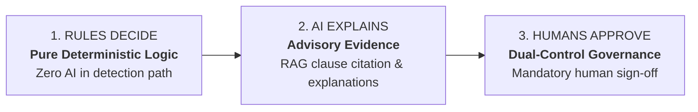
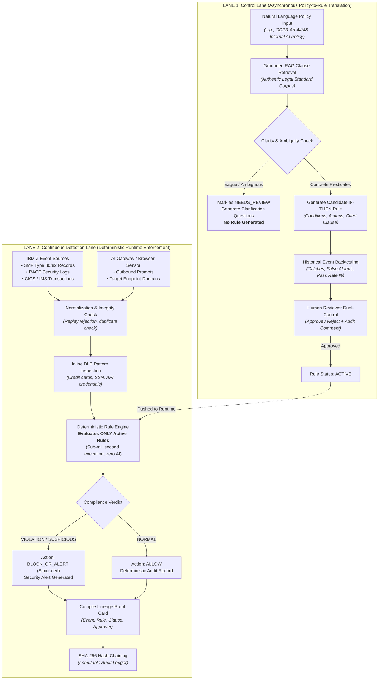
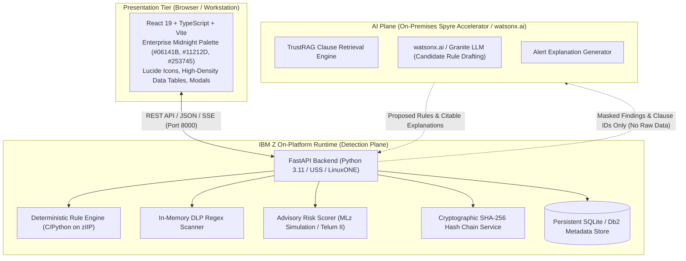

# Sentinel AI — Technical Architecture, Technology Stack & Operational Blueprint
### Enterprise AI Governance & Real-Time Compliance on IBM Z
**Tagline:** *Policy → Rule → Proof*  
**Architecture Model:** Dual-Lane Operational Decoupling  
**Target Platform:** IBM Z / z/OS & IBM LinuxONE (`s390x` / Ubuntu 24.04)

---

## 1. Executive Summary & Governing Axioms

**Sentinel AI** bridges the operational gap between unstructured regulatory mandates (GDPR, PCI-DSS, HIPAA, SOX) and millisecond-level enterprise transaction streams on IBM Z mainframes, while closing blind spots created by unmonitored workforce usage of external generative AI tools.

Most enterprise compliance solutions attempt to solve this either through yearly manual audits or by delegating sensitive access decisions to non-deterministic large language models (LLMs). Sentinel AI rejects both flawed paradigms by enforcing three governing axioms:



1. **RULES DECIDE:** Real-time event streams (SMF, RACF, CICS, IMS) and AI prompt egress are evaluated **deterministically**. AI never makes the final compliance decision.
2. **AI EXPLAINS:** Generative models interpret unstructured policy documents, propose candidate IF–THEN rules grounded in cited legal standards, and synthesize plain-language alert explanations from recorded metadata.
3. **HUMANS APPROVE:** Candidate rules require explicit human compliance review and sign-off before entering the active runtime registry.

---

## 2. Dual-Lane Operational Workflow Architecture

The core operational differentiator of Sentinel AI is its **dual-lane decoupling**, which completely isolates asynchronous generative AI workflows from inline, real-time transaction enforcement.



---

## 3. End-to-End System Architecture



### Security Boundary & Zero-Data-Movement
> [!IMPORTANT]
> **Data Privacy by Design:** Sensitive mainframe customer records, account balances, and raw employee prompts **never cross the IBM Z platform boundary**. The off-platform AI plane receives only anonymized metadata tokens and clause identifiers. Inline DLP scans outgoing prompts in-memory, redacting credit cards and credentials before discarding prompt text.

---

## 4. Comprehensive Technology Stack

| Layer | Component | Technology / Framework | Purpose & Specification |
| :--- | :--- | :--- | :--- |
| **Frontend UI** | Framework | **React 19** + **TypeScript** | High-performance, strictly typed component architecture |
| | Bundler & Dev Server | **Vite 8** | Sub-second HMR, optimized production tree-shaking |
| | Design System | **Custom Enterprise Palette** | Styled precisely with `#06141B`, `#11212D`, `#253745`, `#4A5C6A`, `#9BA8AB`, `#CCD0CF` |
| | Iconography | **Lucide React** | Consistent, scalable enterprise security icons |
| **Backend API** | Web Framework | **FastAPI 0.143** | Asynchronous high-throughput ASGI REST API with Pydantic validation |
| | ASGI Server | **Uvicorn 0.54** | Lightning-fast asynchronous server running on Python 3.11/3.15 |
| | Rule Engine | **Deterministic Evaluator** | Pure condition-matching logic; zero runtime dependency on AI models |
| | DLP Inspection | **Python Compiled Regex** | In-memory pattern scanning for PAN (Luhn), SSN, emails, and API keys |
| | Advisory Scorer | **MLz Emulation** | Tabular access anomaly scoring simulating Machine Learning for z/OS |
| **Integrity & Storage** | Cryptographic Ledger | **Python `hashlib` SHA-256** | Canonical JSON serialization + sequential digest chaining ($H_N = \text{SHA-256}(\text{Card}_N + H_{N-1})$) |
| | Persistence | **SQLite 3 (WAL mode)** | Lightweight embedded transactional database (Db2 metadata ready) |
| | Ground Truth | **Python `csv` / `json`** | Validated ingestion of `ibm_z_sentinel_ai_sample_events.csv` and `legal_clauses.json` |
| **Quality & QA** | Test Suite | **Pytest 9.1** + **HTTPX** | Automated tests for rule logic, approvals, CSV ground truth, and hash tampering |
| **Target Infrastructure** | Target Hardware | **IBM Z16 / Z17** | Telum II on-chip AI acceleration, CPACF hardware cryptography |
| | Target OS | **Ubuntu 24.04 (`s390x`)** | IBM LinuxONE virtual machine running Docker |
| | Containerization | **Docker Multi-Arch** | Multi-architecture base image supporting `linux/s390x` and `linux/amd64` |

---

## 5. Detailed Operational Workflows

### 5.1. Policy-to-Rule Translation (Lane 1)
1. **Policy Ingestion:** The compliance officer submits policy text (e.g., *"Personal customer data must not be sent to unapproved external AI services"*).
2. **RAG Grounding:** The system scans `backend/app/data/legal_clauses.json` and retrieves authentic regulatory articles (e.g. `ENT-AI-SEC-01` or `GDPR-ART-44/48`).
3. **Clarity Analysis:** If the policy text is vague (e.g. *"Handle data appropriately"*), the engine refuses to create an active rule, sets status to `NEEDS_REVIEW`, and returns explicit clarification questions.
4. **Candidate Rule Formulation:** For valid policies, an IF–THEN rule is drafted with boolean conditions:
   ```json
   {
     "rule_name": "Restrict Sensitive Data Transmission to External AI",
     "source_clause_id": "ENT-AI-SEC-01",
     "conditions": [
       {"field": "sensitive_data", "operator": "==", "value": true},
       {"field": "is_unapproved_destination", "operator": "==", "value": true}
     ],
     "classification": "PRIVACY_VIOLATION",
     "recommended_action": "BLOCK_OR_ALERT",
     "risk_level": "HIGH",
     "status": "PENDING_APPROVAL"
   }
   ```
5. **Backtesting:** Before review, the candidate rule is replayed against the 15 ground-truth benchmark events in `ibm_z_sentinel_ai_sample_events.csv`. Catches, false alarms, and pass rates are calculated.
6. **Dual-Control Human Sign-off:** A human compliance reviewer reviews the clause, rule predicates, and backtest results side-by-side. Only upon explicit `APPROVE` does the rule become `ACTIVE`.

### 5.2. Deterministic Event Enforcement (Lane 2)
1. **Event Ingestion:** Simulated IBM Z events (SMF/RACF, CICS/IMS) and AI prompt egress are ingested and normalized.
2. **Integrity Validation:** Duplicate event IDs are rejected to prevent replay attacks.
3. **Inline DLP:** Prompts are inspected for sensitive data categories (Payment cards, SSN, API tokens) and sanitized.
4. **Deterministic Evaluation:** The event is matched against the list of `ACTIVE` rules. Unapproved or draft rules are completely bypassed.
5. **Verdict Generation:**
   - **`NORMAL`** ➔ `ALLOW`
   - **`PRIVACY_VIOLATION`** ➔ `BLOCK_OR_ALERT` (Simulated action)
   - **`SUSPICIOUS`** ➔ `INVESTIGATE` / `ALERT_AND_REVIEW`
   - **`HUMAN_REVIEW`** ➔ `REVIEW`
6. **Alert Dispatch:** Non-normal classifications generate an alert with cited clause evidence and recommended remediation.
7. **Proof Card Construction:** Execution lineage fields are packaged into an immutable Proof Card.

### 5.3. Cryptographic SHA-256 Ledger & Tamper Verification
Every event evaluation creates a cryptographic record containing:
- `event_id`, `event_timestamp`, `detection_timestamp`
- `rule_id`, `rule_version`, `policy_id`, `policy_version`
- `cited_clause_id`, `classification`, `recommended_action`
- `approver_id`, `approval_time`
- `previous_hash`, `current_hash`

#### Mathematical Hash Chaining Formula:
$$\text{Payload}_N = \text{CanonicalSerialize}(\text{ProofCard}_N)$$
$$H_N = \text{SHA-256}(\text{Payload}_N + H_{N-1})$$
$$H_0 = \text{GENESIS\_HASH} = \text{"0000000000000000000000000000000000000000000000000000000000000000"}$$

* **Verification Engine:** Recomputes canonical hashes for every sequential block. If any record's payload, classification, or approver is maliciously modified in the database, the linear dependency is broken.
* **Tamper Simulation:** An interactive demo button intentionally mutates a test record in the database. Running verification immediately detects the hash mismatch and pinpoints the exact corrupted block ID.

### 5.4. Degraded Mode Fault Tolerance
* When external AI services (`watsonx.ai` or cloud models) experience downtime or latency spikes, an interactive toggle switches the AI Plane to **DEGRADED MODE**.
* **Zero Dependency:** Deterministic detection, DLP scanning, alert logging, and SHA-256 ledger verification continue running without degradation, proving that critical mainframe compliance controls never depend on an external AI model being online.

---

## 6. Multi-Industry Configuration Matrix

The application provides multi-industry configuration profiles without duplicating code:

| Sector | Governing Frameworks | Protected Mainframe Resources | Sensitive Data Categories | Bulk Threshold |
| :--- | :--- | :--- | :--- | :--- |
| **Banking** | GDPR Art 44/48, PCI-DSS 4.0, SOX 404, FFIEC | `CUSTOMER_DB`, `CORE_LEDGER`, `SWIFT_PAYMENTS`, `PAYROLL_DB` | IBAN, PAN, Transaction History, SWIFT MT103, SSN | 5,000 records |
| **Healthcare** | HIPAA Security Rule, HITECH, GDPR Art 9 | `EHR_SYSTEM`, `PATIENT_RECORD_DB`, `CLINICAL_TRIALS`, `PHARMACY_RX` | PHI, ICD-10 Diagnostic Codes, RX History, Member ID | 1,000 records |
| **Insurance** | NAIC Model Law, NYDFS 23 NYCRR 500, GDPR | `POLICYHOLDER_DB`, `CLAIMS_PROCESSING`, `ACTUARIAL_MODELS` | Claim Financials, Medical Underwriting, Beneficiaries | 3,000 records |
| **Retail** | CCPA / CPRA, PCI-DSS 4.0, FTC Act Sec 5 | `LOYALTY_PROGRAM_DB`, `POS_CHECKOUT_STREAM`, `INVENTORY_Z` | PAN Cards, Geolocation, Loyalty PII, Purchase Profiles | 10,000 records |

---

## 7. IBM LinuxONE (`s390x`) Deployment Specifications

The backend is packaged with a multi-architecture Dockerfile supporting IBM LinuxONE (`s390x`) on Ubuntu 24.04:

```dockerfile
FROM python:3.11-slim
WORKDIR /app
RUN apt-get update && apt-get install -y --no-install-recommends curl ca-certificates && rm -rf /var/lib/apt/lists/*
COPY requirements.txt .
RUN pip install --no-cache-dir -r requirements.txt
COPY app/ ./app/
ENV PYTHONUNBUFFERED=1 SENTINEL_HOST=0.0.0.0 SENTINEL_PORT=8000 SENTINEL_DB_PATH=/app/sentinel_ai.db
EXPOSE 8000
HEALTHCHECK --interval=30s --timeout=5s --start-period=5s --retries=3 CMD curl -f http://localhost:8000/api/health || exit 1
CMD ["python", "-m", "uvicorn", "app.main:app", "--host", "0.0.0.0", "--port", "8000"]
```

### Deployment Commands on LinuxONE:
```bash
# Build container for s390x
docker build -t sentinel-ai:latest -f backend/Dockerfile backend/

# Run container on port 8000 (preserving existing JupyterLab on 8888)
docker run -d --name sentinel-ai --restart unless-stopped -p 8000:8000 -v sentinel_data:/app sentinel-ai:latest

# Health check
curl -f http://localhost:8000/api/health
```

---

## 8. Quantum-Safe Cryptography Roadmap

To ensure compliance evidence remains tamper-evident against future quantum computer decryption risks:
1. **Cryptographic Discovery:** Uses IBM Z Cybersecurity Discovery and Inventory (zCDI) and SMF Type 82 records in ICSF to map classical public-key cryptography (RSA/ECC).
2. **Hybrid Post-Quantum Transition:** Executes classical algorithms concurrently with NIST standards:
   - **ML-KEM:** Post-quantum key encapsulation for secure cross-platform data exchange.
   - **ML-DSA:** Post-quantum digital signatures for signing Proof Cards and ledger checkpoints.
3. **Crypto-Agility:** Verification layer calls abstract ICSF coprocessor interfaces rather than hardcoding cryptographic primitives, allowing seamless algorithm upgrades without application refactoring.
